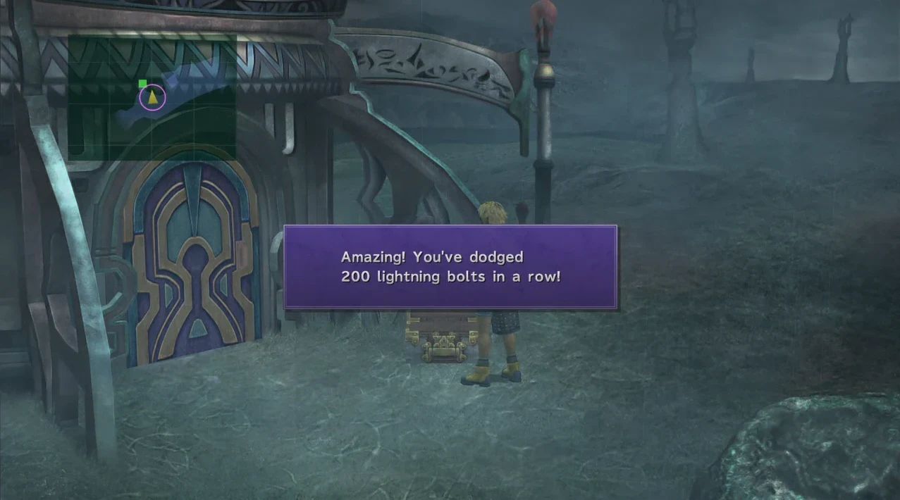
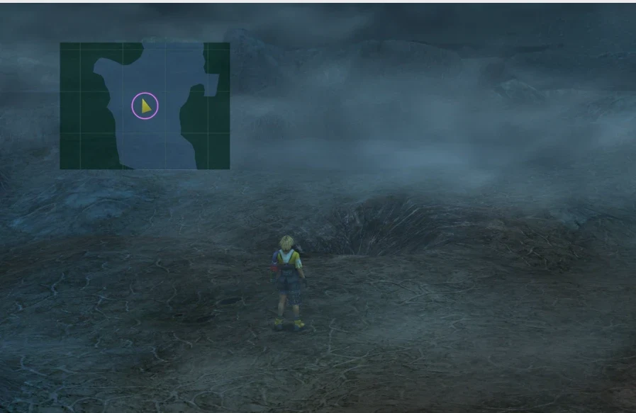

# ⚡ raios-ffx

🇺🇸 **English** · 🇧🇷 [Leia em português](README.pt-BR.md)

**Dodge all 200 lightning bolts on the Thunder Plains in Final Fantasy X without pressing a thing.**

A small Linux program that watches the **Chiaki** window (the PlayStation Remote Play app) and presses **✕** for you the instant the lightning flashes the screen. You can walk around the Thunder Plains freely, or even put the controller down, and your character dodges on their own. At the end, the **Venus Sigil** (the sigil for Lulu's celestial weapon) is waiting for you.

> Built and tested with **Final Fantasy X HD (PlayStation 4)** played over **Remote Play with chiaki-ng** on Linux.

<p align="center">
  
  <br>
  <em>The result: 200 bolts dodged in a row with raios-ffx, and the Venus Sigil chest waiting outside Rin's Travel Agency.</em>
</p>

---

## 📖 Contents

- [The challenge](#-the-challenge)
- [How the program solves it](#-how-the-program-solves-it)
- [Where it works](#-where-it-works)
- [What you need](#-what-you-need)
- [Before you start: the terminal](#-before-you-start-the-terminal)
- [Step-by-step installation](#-step-by-step-installation)
- [How to use it](#-how-to-use-it)
- [Where to stand on the Thunder Plains](#-where-to-stand-on-the-thunder-plains)
- [Tips and tweaks](#-tips-and-tweaks)
- [Troubleshooting](#-troubleshooting)
- [FAQ](#-faq)
- [License](#-license)

---

## 🎯 The challenge

On the **Thunder Plains**, lightning strikes all the time. Right before each bolt, the screen flashes white. If you press **✕** at that moment, your character jumps and dodges.

To earn the **Venus Sigil**, which completes Lulu's celestial weapon (*Onion Knight*), you must dodge **200 bolts in a row**. That's several minutes of total focus, staring at the screen, without a single mistake. Get hit once and the count goes back to zero. And the game **never shows** how many you've dodged.

It's exactly the kind of repetitive task a computer does better than we do.

## 🧠 How the program solves it

The idea is simple:

```
 ┌──────────────┐       ~60x per second     ┌──────────────────────┐
 │ Chiaki       │ ────────────────────────▶ │ Measures the average │
 │ window       │                           │ brightness of the    │
 └──────────────┘                           │ center of the screen │
                                            └──────────┬───────────┘
                                                       │
                     sudden jump in brightness?        │  (e.g. 60 → 200)
                                                       ▼
 ┌──────────────┐                           ┌──────────────────────┐
 │ PlayStation  │ ◀──── Chiaki sends ────── │ Presses ✕ on a       │
 │ (dodge! ⚡)  │                           │ virtual controller   │
 └──────────────┘                           └──────────────────────┘
```

1. **Watches the screen.** The program finds the Chiaki window and, about 60 times per second, measures how bright its central area is.
2. **Learns what "normal" looks like.** The Thunder Plains are dark. The program keeps track of the scene's normal brightness, which changes slowly as the camera moves or you walk around.
3. **Spots the lightning.** When the brightness suddenly jumps by a lot, that's the lightning flash.
4. **Presses ✕.** The program creates a **virtual controller** (an invisible "pretend" controller, using a Linux feature called `uinput`) and presses ✕ on it. Chiaki combines the buttons from every connected controller and sends them to the console. That's why **your real controller keeps working normally**: you can walk around while the program takes care of the lightning.
5. **Waits a moment.** After each bolt, it waits a little over 1 second before pressing again, so it doesn't press twice for the same flash.

Nothing is installed on the console and nothing in the game is modified. The program only does what you would do: watch the screen and press a button at the right time.

**Why is it so lightweight?** On purpose, it doesn't use any big image-processing libraries. It measures brightness with simple math, which is all it takes to catch the flash. It only needs Python (which already comes with Linux) and two small packages.

## 🕹️ Where it works

| Setup | Works? |
|---|---|
| **PS4 + Chiaki (chiaki-ng) on Linux** | ✅ Yes, this is where it was built and tested |
| **PS5 + Chiaki on Linux** | 🟡 Should work. Chiaki connects to the PS5 the same way, but it hasn't been tested yet |
| PC version (Steam) | ❓ Not tested. For now, this project is only for PlayStation through Chiaki |
| Windows or macOS | ❌ No. The program relies on Linux-specific features (`uinput` and X11) |
| Linux on Wayland | ⚠️ Probably not. Screen capture uses X11; on Wayland the image may come out black |

## 🧰 What you need

- **Linux** running **X11** (the default on Linux Mint; on Ubuntu, pick the "Xorg" session on the login screen)
- **Chiaki** or **chiaki-ng** already connected to your PlayStation (installed from the app store/Flatpak or any other way, it doesn't matter)
- **Final Fantasy X** (or FFX/X-2 HD Remaster) running on the console
- **Python 3**: it already comes with virtually every Linux system. You don't need to download it.
- Two small packages, which the installation below adds for you if they're missing:
  - `python3-xlib`: lets the program "see" the screen
  - `wmctrl`: lets the program find the Chiaki window

## 💻 Before you start: the terminal

Everything here is done in the **terminal**, the black (or dark) window where you type commands. You don't need to know how to program: just **copy and paste** the commands from this guide.

**How to open the terminal:**
- Press **Ctrl + Alt + T** at the same time. On most Linux systems (Mint, Ubuntu and others), this opens the terminal right away.
- Or search for **"Terminal"** in your applications menu.

**How to paste a command into the terminal:**
1. Here on GitHub, hover over the grey command box and click the **copy** button 📋 that appears in its right corner.
2. In the terminal, paste with **Ctrl + Shift + V** (note: in the terminal it's **with Shift**) or right-click → **Paste**.
3. Press **Enter**.

> 📋 **What to copy:** only the text inside the **grey boxes** that come right after **👇 Copy this**. Everything else on this page (headings, explanations, lists) is just for you to read: **don't paste it into the terminal**. The easiest way is the 📋 button in the box's right corner, which copies it exactly.

**When the terminal asks for a password:**
- Some commands start with `sudo`, which means "do this as administrator". They ask for **the same password you use to log in to your computer**.
- **Nothing shows up on screen while you type the password**, not even dots or asterisks. That's normal and it's for your security. Type the password and press **Enter**.

**How to tell it worked:** when a command finishes, the terminal shows the line where you type again (something like `yourname@computer:~$`). If you see an error message, check [Troubleshooting](#-troubleshooting).

## 📦 Step-by-step installation

You only do this **once**. There are 3 steps.

### Step 1: install the packages the program uses

Copy, paste into the terminal and press Enter. It will ask for your password (remember: it doesn't show while you type). If it asks `Do you want to continue? [Y/n]`, type **Y** and press Enter.

👇 **Copy this** (Linux Mint, Ubuntu, Pop!_OS, Debian and similar):

```bash
sudo apt install python3-xlib wmctrl
```

<details>
<summary>Using Fedora or Arch? Click here</summary>

👇 **Copy this** (Fedora):

```bash
sudo dnf install python3-xlib wmctrl
```

👇 **Copy this** (Arch / Manjaro):

```bash
sudo pacman -S python-xlib wmctrl
```

</details>

✅ **It worked if** it finishes without errors. If it says *"is already the newest version"*, that's fine too: it means you already had the packages.

### Step 2: download the program

👇 **Copy this**: the whole box, all 3 lines together (the 📋 button copies all 3). Paste it into the terminal and press Enter:

```bash
mkdir -p ~/.local/bin
curl -o ~/.local/bin/raios-ffx https://raw.githubusercontent.com/KakaXIV/raios-ffx/main/raios-ffx
chmod +x ~/.local/bin/raios-ffx
```

What each line does, so you know:
1. Creates the folder for your personal programs (`~/.local/bin`), if it doesn't exist yet.
2. Downloads the program from this GitHub page into that folder.
3. Marks the file as a "program", so it can be run.

✅ **It worked if** you see a little download table ending in `100`.

> **Rather skip the terminal for this step?** Click the green **Code → Download ZIP** button at the top of this page, extract it, and copy the `raios-ffx` file into the `.local/bin` folder inside your home folder (press **Ctrl + H** in your file manager to see folders that start with a dot). Then paste only this line into the terminal: `chmod +x ~/.local/bin/raios-ffx`

### Step 3: check the virtual controller permission

The program needs permission to create the invisible controller. Check it with the command below.

👇 **Copy this:**

```bash
test -w /dev/uinput && echo "All good" || echo "uinput needs to be allowed"
```

- If it prints **"All good"**: you're done, skip to [How to use it](#-how-to-use-it). (If you have **Steam** installed, you almost always have this permission already.)
- If it prints **"uinput needs to be allowed"**: use the box below, press Enter, type your password and then **restart your computer**.

👇 **Copy this** (only if it printed "uinput needs to be allowed"; the whole box, both lines together):

```bash
echo 'KERNEL=="uinput", SUBSYSTEM=="misc", TAG+="uaccess", OPTIONS+="static_node=uinput"' | sudo tee /etc/udev/rules.d/60-uinput-usuario.rules
sudo udevadm control --reload && sudo udevadm trigger
```

After restarting, run the check command again. It should print "All good".

## ▶️ How to use it

**In short:** start the program in the terminal with `raios-ffx`, then press **F7** to turn it on. **F7** again turns it off.

1. Open **Chiaki** and connect to your PlayStation. Don't minimize its window. Another window on top is fine: the program reads the picture straight from Chiaki's window.
2. In the game, go to the **Thunder Plains**.
3. Open the terminal (**Ctrl + Alt + T**), paste the command below and press Enter.

   👇 **Copy this:**

   ```bash
   raios-ffx
   ```

4. The program starts **turned off** and shows this (the box below is just an **example**: **no need to copy it**):

   ```
   Ready. Press F7 to turn ON and F7 again to turn OFF. Ctrl+C here closes the script.
   OFF
   ```

   Leave this terminal window open (it can sit behind Chiaki) while you play.

5. **Press F7** (the F7 key on the top row of your keyboard) to turn it **ON**. You don't need to click the terminal first: F7 works whatever window is in front, Chiaki included. The terminal shows `ON` and, every time lightning strikes, a new line:

   ```
   ON - you can walk around the Thunder Plains (preferably around the craters).
   ⚡ bolt 1  (brightness 60 -> 203)
   ⚡ bolt 2  (brightness 59 -> 203)
   ```

6. **You can walk around freely.** Your character jumps on their own when the lightning strikes, even while walking. You don't have to stand still. See [where it's best to be](#-where-to-stand-on-the-thunder-plains) below.
7. For the **first few bolts**, watch the screen and make sure your character is **jumping to dodge**.
8. Past **200**? Let another **10 to 15** strike, just to be safe. Then:
   - press **F7** to turn it **OFF** (the terminal shows `OFF`);
   - head straight, without getting hit, to the **chest just outside Rin's Travel Agency** (in the middle of the Thunder Plains, between the northern and southern parts). The Venus Sigil is inside.
9. To **close** the program for good, click the terminal and press **Ctrl + C**.

| Key | What it does |
|---|---|
| **F7** | Turns lightning detection on / off (works with Chiaki in front) |
| **Ctrl + C** (in the terminal) | Closes the program for good |

> ⚠️ **Turn it off with F7 before leaving the Thunder Plains.** While it's on, any flash on screen, such as the start of a battle, makes it press ✕.

> ℹ️ **The number in the terminal is not the game's count.** It counts the flashes it has seen since it was started. If your character gets hit by lightning (during a battle, for example), the game resets its count, but the program keeps counting.

> ⌨️ **F7 is reserved** while the program is open: other programs don't receive that key. If another program of yours also uses F7, don't keep both open at the same time.

## 🗺️ Where to stand on the Thunder Plains

You don't need to stand still: you can walk around the map and the program dodges for you.

**The best spot is walking around the craters.** There are craters in the ground on the Thunder Plains, and lightning strikes almost every time you step into one. If you circle the craters, stepping in and out, the bolts become frequent and predictable, and you'll reach 200 much faster.

### ⭐ The perfect crater

<p align="center">
  
  <br>
  <em>The best crater for dodging: south of Rin's Travel Agency. Use the minimap shape to find it.</em>
</p>

This crater is the best spot of all. **Just keep walking in and out of it using only the analog stick**: lightning strikes over and over, and the program in the terminal presses ✕ for every bolt automatically. You don't need to touch any other button.

**How to get there:** from **Rin's Travel Agency**, head **south**, back the way you came, toward the exit to **Guadosalam** (the Guado town where Seymour lives). Keep an eye on the **minimap** in the top-left corner: when it matches the shape in the picture above, the crater is right in front of you.

A few tips:
- **Stay away from the lightning towers.** They protect you, so hardly any lightning falls near them.
- **Random battles:** the start of a battle has a flash, and the program may press ✕ at that moment. At most it picks a command in the menu, but keep an eye on it.
- **Don't leave the Thunder Plains** until you've collected the prize: leaving resets the count.

## 🔧 Tips and tweaks

**Test mode.** Shows the screen brightness in real time **without pressing anything** (it starts already on, no F7 needed). Handy to check that the program can "see" Chiaki.

👇 **Copy this:**

```bash
raios-ffx --test
```

The numbers should change when you move the camera in the game. To quit, press **Ctrl + C**.

**Delay.** If your character gets hit because the press came too early (rare), you can wait a few milliseconds after the flash.

👇 **Copy this:**

```bash
raios-ffx --delay 50
```

**Sensitivity.** At the top of the `raios-ffx` file there are three values you can change with any text editor:

| Value | What it does | Default |
|---|---|---|
| `FLASH_JUMP` | How much the brightness must jump suddenly to count as lightning. Raise it if it presses with no lightning; lower it if it misses bolts. | `55` |
| `COOLDOWN` | Seconds to wait before pressing again after a bolt | `1.2` |
| `STAY_BRIGHT` | If the screen stays bright for longer than this (in seconds), the scene got brighter, it's not a bolt, so it doesn't count | `0.8` |

**Connection.** The more stable the connection between your computer and the console, the better. A network cable on the console helps a lot.

## 🩹 Troubleshooting

**`raios-ffx: command not found`**
The `~/.local/bin` folder only gets added to the terminal's "path" after you log out and back in (or restart your computer). Do that, or, in the meantime, run the program using its full path.

👇 **Copy this:**

```bash
~/.local/bin/raios-ffx
```

**"Couldn't find the Chiaki window, waiting..."**
The program looks for Chiaki's own window (by window type, not by title, so a browser tab with "Chiaki" in its name no longer confuses it). Make sure Chiaki is open and not minimized. The `wmctrl -lx` command lists the open windows: Chiaki's shows up as `chiaki.Chiaki`.

**I pressed F7 and nothing happened**
Check that the terminal shows `Ready. Press F7...`. If another program is already using F7, this one won't get the key: close the other one and start `raios-ffx` again. On some laptops the F keys only work while holding **Fn** (Fn + F7).

**Lightning strikes, but nothing shows up in the terminal**
First check that it is `ON` (press F7). Then run `raios-ffx --test`. If the brightness is always `0`, your session is probably Wayland. Log out and, on the login screen, choose the "Xorg" or "X11" session.

**"⚡ bolt" shows up, but the character doesn't jump**
- Click once on the Chiaki window and make sure your controller works in it.
- Close and reopen Chiaki **with the program already running**, so it picks up the virtual controller.
- Check the virtual controller permission ([step 3](#step-3-check-the-virtual-controller-permission)).

**`PermissionError` with `/dev/uinput`**
The permission from [step 3](#step-3-check-the-virtual-controller-permission) is missing.

**`ModuleNotFoundError: No module named 'Xlib'`**
The package from [step 1](#step-1-install-the-packages-the-program-uses) is missing. Run it again.

## ❓ FAQ

**Do I need to download Python or any separate library?**
No. Python already comes with Linux, and step 1 installs the two small packages that may be missing. No `pip`, virtual environment or anything like that.

**Can I use my controller while the program is running?**
Yes. The program uses its own separate virtual controller, and Chiaki combines both. You walk around with your controller and the program only presses ✕ when lightning strikes.

**Is this cheating? Can I get banned?**
The program doesn't modify the game, the console or the network. It only watches the screen and presses a button, just like a person would. FFX is a single-player game with no online mode. Still, use it at your own risk.

**Can it break anything on my computer?**
Very unlikely. The program doesn't delete or change any files, doesn't need administrator rights to run, and the virtual controller disappears on its own when it closes. The only system change is the optional permission in step 3, the same one Steam uses.

**Why does the virtual controller identify itself as a generic USB adapter?**
Chiaki uses the SDL library to understand controllers. SDL already knows this adapter and which button is ✕. That way the program works with no extra setup.

**What language does the program speak?**
It picks it automatically: if your system is set to Portuguese, the messages show up in Portuguese; otherwise, in English. The options work in both languages too (`--test` or `--teste`, `--delay` or `--atraso`). Only the text changes: the lightning detection is exactly the same.

**Does it work with other games?**
The idea (reacting to a flash on screen by pressing a button) can work for other reflex minigames. The code, however, was built and tuned for the Thunder Plains.

---

## 📄 License

[MIT](LICENSE): feel free to use, modify and share.
