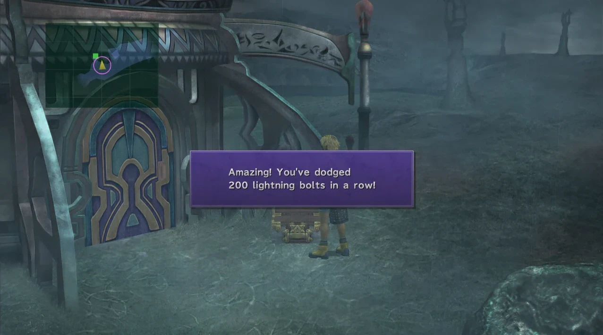

# ⚡ raios-ffx

🇺🇸 [Read in English](README.md) · 🇧🇷 **Português**

**Desvie dos 200 raios das Planícies dos Trovões, em Final Fantasy X, sem precisar apertar nada.**

Um programa pequeno para Linux que observa a tela do **Chiaki** (o app de Remote Play de PlayStation) e aperta **X** sozinho no exato momento em que o raio clareia a tela. Você pode andar pelas Planícies à vontade, ou até largar o controle, que o personagem desvia sozinho. No final, a **Venus Sigil** (o selo da arma celestial da Lulu) está esperando por você.

> Feito e testado com **Final Fantasy X HD (PlayStation 4)** jogado via **Remote Play no chiaki-ng**, em Linux.

<p align="center">
  
  <br>
  <em>O resultado: 200 raios desviados seguidos com o raios-ffx, e o baú da Venus Sigil esperando na porta da Agência de Viagem da Rin.</em>
</p>

---

## 📖 Sumário

- [O desafio](#-o-desafio)
- [Como o programa resolve](#-como-o-programa-resolve)
- [Onde funciona](#-onde-funciona)
- [O que você precisa](#-o-que-você-precisa)
- [Antes de começar: o terminal](#-antes-de-começar-o-terminal)
- [Instalação passo a passo](#-instalação-passo-a-passo)
- [Como usar](#-como-usar)
- [Onde ficar nas Planícies](#-onde-ficar-nas-planícies)
- [Dicas e ajustes](#-dicas-e-ajustes)
- [Problemas comuns](#-problemas-comuns)
- [Perguntas frequentes](#-perguntas-frequentes)
- [Licença](#-licença)

---

## 🎯 O desafio

Nas **Planícies dos Trovões** (*Thunder Plains*), raios caem o tempo todo. Logo antes de cada raio, a tela pisca em branco. Se você apertar **X** nesse instante, o personagem dá um pulinho e desvia.

Para ganhar a **Venus Sigil**, que completa a arma celestial da Lulu (*Onion Knight*), é preciso desviar de **200 raios seguidos**. São uns bons minutos de concentração total, olhando para a tela, sem errar nenhuma vez. Se levar um raio, a contagem volta para zero. E o jogo **não mostra** quantos você já desviou.

É o tipo de tarefa repetitiva que um computador faz melhor que a gente.

## 🧠 Como o programa resolve

A ideia é simples:

```
 ┌──────────────┐     ~60x por segundo      ┌─────────────────────┐
 │ Janela do    │ ────────────────────────▶ │ Mede o brilho médio │
 │ Chiaki       │                           │ do meio da tela     │
 └──────────────┘                           └──────────┬──────────┘
                                                       │
                       brilho deu um salto repentino?  │  (ex.: 60 → 200)
                                                       ▼
 ┌──────────────┐                           ┌─────────────────────┐
 │ PlayStation  │ ◀──── Chiaki envia ────── │ Aperta X num        │
 │ (desvia! ⚡) │                           │ controle virtual    │
 └──────────────┘                           └─────────────────────┘
```

1. **Olha a tela.** O programa encontra a janela do Chiaki e, cerca de 60 vezes por segundo, mede o quão clara está a parte central dela.
2. **Aprende o "normal".** As Planícies são escuras. O programa acompanha o brilho normal da cena, que muda devagar conforme a câmera se mexe ou você anda.
3. **Percebe o raio.** Quando o brilho dá um salto repentino e grande, é o clarão do raio.
4. **Aperta X.** O programa cria um **controle virtual** (um controle "de mentira", invisível, usando um recurso do próprio Linux chamado `uinput`) e aperta X nele. O Chiaki junta os botões de todos os controles conectados e manda para o console. Por isso **o seu controle de verdade continua funcionando normalmente**: você pode andar enquanto o programa cuida dos raios.
5. **Espera um pouco.** Depois de cada raio, fica pouco mais de 1 segundo sem apertar, para não apertar duas vezes no mesmo clarão.

Nada é instalado no console e nada é modificado no jogo. O programa só faz o que você faria: olhar a tela e apertar um botão na hora certa.

**Por que ele é tão leve?** De propósito, ele não usa bibliotecas grandes de processamento de imagem. Mede o brilho com contas simples, o que basta para perceber o clarão. Só precisa do Python (que já vem no Linux) e de dois pacotinhos pequenos.

## 🕹️ Onde funciona

| Situação | Funciona? |
|---|---|
| **PS4 + Chiaki (chiaki-ng) no Linux** | ✅ Sim, foi onde ele foi feito e testado |
| **PS5 + Chiaki no Linux** | 🟡 Deve funcionar. O Chiaki também conecta ao PS5 do mesmo jeito, mas ainda não foi testado |
| Versão de PC (Steam) | ❓ Não testado. Este projeto, por enquanto, é só para PlayStation via Chiaki |
| Windows ou macOS | ❌ Não. O programa usa recursos específicos do Linux (`uinput` e X11) |
| Linux com Wayland | ⚠️ Provavelmente não. A captura de tela usa X11; em Wayland pode vir tudo preto |

## 🧰 O que você precisa

- **Linux** usando **X11** (o padrão no Linux Mint; no Ubuntu, escolha a sessão "Xorg" na tela de login)
- **Chiaki** ou **chiaki-ng** já conectado ao seu PlayStation (instalado pela loja de aplicativos/Flatpak ou de outro jeito, tanto faz)
- **Final Fantasy X** (ou FFX/X-2 HD Remaster) aberto no console
- **Python 3**: já vem instalado em praticamente todo Linux. Você não precisa baixar.
- Dois pacotes pequenos, que a instalação abaixo coloca para você se faltarem:
  - `python3-xlib`: deixa o programa "olhar" a tela
  - `wmctrl`: deixa o programa achar a janela do Chiaki

## 💻 Antes de começar: o terminal

Tudo aqui é feito no **terminal**, aquela janela preta (ou escura) onde se digitam comandos. Não precisa saber programar: é só **copiar e colar** os comandos deste guia.

**Como abrir o terminal:**
- Aperte **Ctrl + Alt + T** ao mesmo tempo. Na maioria dos Linux (Mint, Ubuntu e outros), isso abre o terminal na hora.
- Ou procure por **"Terminal"** no menu de aplicativos.

**Como colar um comando no terminal:**
1. Aqui no GitHub, passe o mouse sobre a caixa cinza do comando e clique no botão de **copiar** 📋 que aparece no canto direito.
2. No terminal, cole com **Ctrl + Shift + V** (atenção: no terminal é **com Shift**) ou com o botão direito do mouse → **Colar**.
3. Aperte **Enter**.

**Quando o terminal pedir senha:**
- Alguns comandos começam com `sudo`, que significa "fazer como administrador". Eles pedem **a mesma senha que você usa para entrar no computador**.
- **Enquanto você digita a senha, nada aparece na tela**, nem bolinhas nem asteriscos. Isso é normal e é para sua segurança. Digite a senha e aperte **Enter**.

**Como saber se deu certo:** quando o comando termina, o terminal volta a mostrar a linha onde você digita (algo como `seunome@computador:~$`). Se aparecer uma mensagem de erro, veja [Problemas comuns](#-problemas-comuns).

## 📦 Instalação passo a passo

Você só faz isso **uma vez**. São 3 passos.

### Passo 1: instalar os pacotes que o programa usa

Copie, cole no terminal e aperte Enter. Ele vai pedir sua senha (lembre: ela não aparece enquanto você digita). Se perguntar `Continuar? [S/n]`, digite **S** e aperte Enter.

**Linux Mint, Ubuntu, Pop!_OS, Debian e parecidos:**

```bash
sudo apt install python3-xlib wmctrl
```

<details>
<summary>Usa Fedora ou Arch? Clique aqui</summary>

Fedora:

```bash
sudo dnf install python3-xlib wmctrl
```

Arch / Manjaro:

```bash
sudo pacman -S python-xlib wmctrl
```

</details>

✅ **Deu certo se** terminar sem erro. Se aparecer *"já é a versão mais nova"*, também está certo: significa que você já tinha os pacotes.

### Passo 2: baixar o programa

Copie e cole **o bloco inteiro** de uma vez (são 3 linhas) e aperte Enter:

```bash
mkdir -p ~/.local/bin
curl -o ~/.local/bin/raios-ffx https://raw.githubusercontent.com/KakaXIV/raios-ffx/main/raios-ffx
chmod +x ~/.local/bin/raios-ffx
```

O que cada linha faz, para você saber:
1. Cria a pasta onde ficam os seus programas pessoais (`~/.local/bin`), caso ela ainda não exista.
2. Baixa o programa daqui do GitHub para essa pasta.
3. Marca o arquivo como "programa", para ele poder ser executado.

✅ **Deu certo se** aparecer uma tabelinha de download terminando em `100`.

> **Prefere sem terminal?** Clique no botão verde **Code → Download ZIP** aqui no topo da página, extraia o arquivo, e copie o arquivo `raios-ffx` para a pasta `.local/bin` dentro da sua pasta pessoal (aperte **Ctrl + H** no gerenciador de arquivos para ver pastas que começam com ponto). Depois rode só a terceira linha acima (`chmod +x ...`).

### Passo 3: conferir a permissão do controle virtual

O programa precisa de permissão para criar o controle invisível. Confira com:

```bash
test -w /dev/uinput && echo "Tudo certo" || echo "Precisa liberar o uinput"
```

- Se aparecer **"Tudo certo"**: pronto, pode pular para [Como usar](#-como-usar). (Quem tem a **Steam** instalada quase sempre já tem essa permissão.)
- Se aparecer **"Precisa liberar o uinput"**: copie e cole o bloco abaixo, aperte Enter, digite sua senha e depois **reinicie o computador**:

```bash
echo 'KERNEL=="uinput", SUBSYSTEM=="misc", TAG+="uaccess", OPTIONS+="static_node=uinput"' | sudo tee /etc/udev/rules.d/60-uinput-usuario.rules
sudo udevadm control --reload && sudo udevadm trigger
```

Depois de reiniciar, rode o comando de conferir de novo. Deve aparecer "Tudo certo".

## ▶️ Como usar

1. Abra o **Chiaki** e conecte ao seu PlayStation. Deixe a janela dele **visível** na tela: não minimize e não cubra o meio dela com outra janela (o programa precisa "ver" o clarão).
2. No jogo, vá até as **Planícies dos Trovões**.
3. Abra o terminal (**Ctrl + Alt + T**), digite o comando abaixo e aperte Enter:

   ```bash
   raios-ffx
   ```

4. Pronto, ele está ligado. A cada raio, aparece uma linha nova no terminal:

   ```
   Rodando! Pode andar pelas Planícies dos Trovões (de preferência em volta das crateras). Ctrl+C para parar.
   ⚡ raio 1  (brilho 60 -> 203)
   ⚡ raio 2  (brilho 59 -> 203)
   ```

   Deixe essa janela do terminal aberta (pode ficar atrás do Chiaki) enquanto joga.

5. **Você pode andar à vontade.** O personagem pula sozinho na hora do raio, mesmo andando. Não precisa ficar parado num lugar. Veja a seguir [onde é melhor ficar](#-onde-ficar-nas-planícies).
6. Nos **primeiros raios**, olhe a tela e confira se o personagem está **pulando para desviar**.
7. Passou de **200**? Deixe cair mais uns **10 a 15** por segurança. Depois:
   - volte ao terminal e aperte **Ctrl + C** para desligar o programa;
   - vá direto, sem levar raio, até o **baú do lado de fora da Agência de Viagem da Rin** (no meio das Planícies, entre a parte norte e a sul). A Venus Sigil está nele.

> ⚠️ **Desligue o programa (Ctrl + C no terminal) antes de sair das Planícies.** Qualquer clarão na tela, como o começo de uma batalha, faz ele apertar X.

> ℹ️ **O número no terminal não é a contagem do jogo.** Ele conta os clarões que viu desde que foi ligado. Se o personagem levar um raio (por exemplo, numa batalha), o jogo zera a contagem dele, mas o programa continua contando. Nesse caso, aperte **Ctrl + C** e ligue de novo com `raios-ffx` para recomeçar do zero.

## 🗺️ Onde ficar nas Planícies

Você não precisa ficar parado: pode andar pelo mapa que o programa desvia por você.

**O melhor é ficar andando em volta das crateras.** Nas Planícies há crateras no chão, e um raio cai quase sempre que você entra nelas. Contornando as crateras, entrando e saindo, os raios ficam frequentes e previsíveis, e os 200 chegam bem mais rápido.

Algumas dicas:
- **Evite ficar perto das torres de para-raios.** Elas protegem você, e aí quase não caem raios.
- **Batalhas aleatórias:** o começo de uma batalha tem um clarão, e o programa pode apertar X nessa hora. No máximo ele escolhe um comando no menu, mas fique de olho.
- **Não saia das Planícies** até pegar o prêmio: sair zera a contagem.

## 🔧 Dicas e ajustes

**Modo teste.** Mostra o brilho da tela em tempo real **sem apertar nada**. Bom para conferir se o programa está "enxergando" o Chiaki:

```bash
raios-ffx --teste
```

Os números devem mudar quando você mexe a câmera no jogo. Para sair, **Ctrl + C**.

**Atraso.** Se o personagem estiver levando raio porque apertou cedo demais (raro), dá para esperar alguns milésimos de segundo depois do clarão:

```bash
raios-ffx --atraso 50
```

**Sensibilidade.** No começo do arquivo `raios-ffx` há dois valores (os nomes estão em inglês, como o resto do código) que você pode mudar com qualquer editor de texto:

| Valor | O que faz | Padrão |
|---|---|---|
| `FLASH_JUMP` | Quanto o brilho precisa subir de repente para contar como raio. Aumente se ele estiver apertando sem raio; diminua se ele estiver perdendo raios. | `55` |
| `COOLDOWN` | Segundos sem apertar de novo depois de um raio | `1.2` |

**Conexão.** Quanto mais estável a conexão entre o computador e o console, melhor. Cabo de rede no console ajuda bastante.

## 🩹 Problemas comuns

**`raios-ffx: comando não encontrado`**
A pasta `~/.local/bin` só entra no "caminho" do terminal depois que você sai da sua conta e entra de novo (ou reinicia o computador). Faça isso, ou, enquanto isso, rode o programa pelo caminho completo:

```bash
~/.local/bin/raios-ffx
```

**"Não achei a janela do Chiaki, esperando..."**
O programa procura uma janela com "chiaki" no título. Confira se o Chiaki está aberto e não minimizado. O comando `wmctrl -l` lista as janelas abertas: a do Chiaki deve aparecer nela.

**Os raios caem, mas nada aparece no terminal**
Rode `raios-ffx --teste`. Se o brilho ficar sempre em `0`, sua sessão provavelmente é Wayland. Saia da conta e, na tela de login, escolha a sessão "Xorg" ou "X11".

**Aparece "⚡ raio", mas o personagem não pula**
- Clique uma vez na janela do Chiaki e confira se o seu controle está funcionando nela.
- Feche e abra o Chiaki **com o programa já rodando**, para ele reconhecer o controle virtual.
- Confira a permissão do controle virtual ([passo 3](#passo-3-conferir-a-permissão-do-controle-virtual)).

**`PermissionError` com `/dev/uinput`**
Falta a permissão do [passo 3](#passo-3-conferir-a-permissão-do-controle-virtual).

**`ModuleNotFoundError: No module named 'Xlib'`**
Falta o pacote do [passo 1](#passo-1-instalar-os-pacotes-que-o-programa-usa). Rode ele de novo.

## ❓ Perguntas frequentes

**Preciso baixar o Python ou alguma biblioteca à parte?**
Não. O Python já vem no Linux, e o passo 1 instala os dois pacotinhos que faltam. Não precisa de `pip`, ambiente virtual nem nada disso.

**Posso usar o controle enquanto o programa roda?**
Pode. O programa usa um controle virtual separado, e o Chiaki junta os dois. Você anda com o seu controle e o programa só aperta X na hora do raio.

**Isso é trapaça? Posso ser banido?**
O programa não modifica o jogo, o console nem a rede. Ele só olha a tela e aperta um botão, como uma pessoa faria. FFX é um jogo de um jogador só, sem modo online. Mesmo assim, use por sua conta e risco.

**Pode estragar alguma coisa no meu computador?**
É bem improvável. O programa não apaga nem altera arquivos, não precisa de senha de administrador para rodar e o controle virtual some sozinho quando ele fecha. A única mudança no sistema é a permissão opcional do passo 3, a mesma que a Steam usa.

**Em que idioma o programa fala?**
Ele escolhe sozinho: se o seu sistema está em português, as mensagens aparecem em português; se não, em inglês. As opções também funcionam nas duas línguas (`--teste` ou `--test`, `--atraso` ou `--delay`). Só o texto muda: a detecção do raio é exatamente a mesma.

**Por que o controle virtual se identifica como um adaptador USB genérico?**
O Chiaki usa a biblioteca SDL para entender os controles. Ela já conhece esse adaptador e sabe qual botão é o X. Assim o programa funciona sem nenhuma configuração extra.

**Funciona com outros jogos?**
O princípio (reagir a um clarão na tela apertando um botão) serve para outros minigames de reflexo. O código, porém, foi feito e ajustado para as Planícies dos Trovões.

---

## 📄 Licença

[MIT](LICENSE): use, modifique e compartilhe à vontade.
